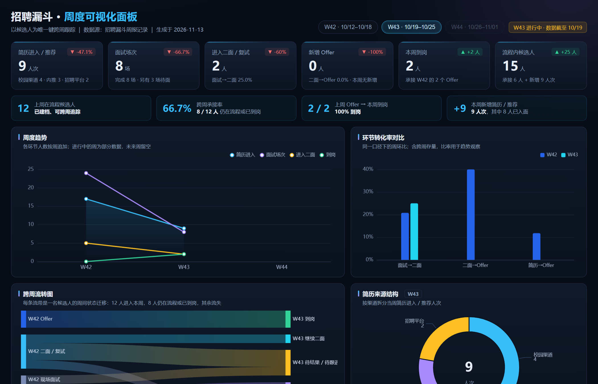
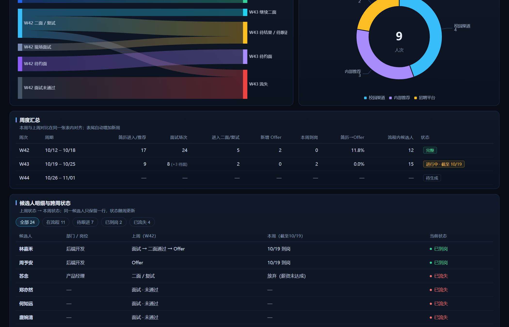

# 招聘漏斗 · 周度可视化面板

**把招聘周报从一堆数字变成一张能看懂的面板。** 以候选人为唯一键跨周跟踪：上周的人在流程里活着还是流失了、这周进了多少简历、卡在哪个环节。

纯静态页面，一个 `index.html` 打开就能看。不需要后端，不需要数据库。



> **本仓库所有候选人、部门、数字均为虚构示例**，仅用于演示面板结构与交互。接真实数据只改 `data.js`。

---

## 为什么做这个

招聘周报通常是这个样子的：

> 本周收到简历 9 份，面试 8 场，进入二面 2 人，无新增 Offer，到岗 2 人。

问题是，这段话回答不了真正要问的东西：

- **上周那 12 个人现在怎么样了？** 没人说
- **到岗的 2 人是上周的 Offer 转化的，还是这周新招的？** 看不出
- **「面试 8 场」是 8 个人面了 1 场，还是 3 个人面了好几场？** 分不清
- **转化率 0%，是这周特别差还是流程本来就这样？** 没有对比基准

这份面板换了个统计口径：**以候选人为唯一键，每周记一次阶段快照，历史不覆盖**。

于是所有跨周问题都能回答了 —— 谁承接了、谁流失了、谁卡住了、Offer 到岗转化要几周。



---

## 面板有什么

### 六个环节 KPI + 周环比

简历进入 / 面试场次 / 进入二面 / 新增 Offer / 本周到岗 / 流程内候选人。每个数字带一句说明和相对于上周的变化。

到岗和流程内是人数变化，用「人」显示；其余用百分比。这个区分很重要 —— 「到岗 +2 人」和「到岗 +200%」在只有 1 人的基数上是同一件事。

### 周度趋势

四个环节按周连成线。进行中的周为部分数据，未来周留空（不是补 0 —— 补 0 会让折线掉到底，看起来像断崖）。

### 环节转化率对比

面试→二面、二面→Offer、简历→Offer 三段转化，按周并列成柱。

**口径提醒**：跨周数值不能直接相除当作同批转化率。这周的 8 场面试里含着上周进入的候选人，分子分母不是同一批人。柱状图只看趋势，不当精确转化率读。

### 跨周流转（桑基图）

这张图是这个面板的核心。每条流带是一名候选人的周间状态迁移：

```
W42 Offer       ──2──→  W43 到岗
W42 二面/复试   ──1──→  W43 继续二面
                ──2──→  W43 待结果/待跟进
                ──1──→  W43 流失
W42 面试未通过  ──3──→  W43 流失
W42 现场面试    ──1──→  W43 待结果/待跟进
W42 待约面      ──2──→  W43 待约面
```

一眼能看出：Offer 转化到岗是 100%，但面试未通过的 3 人全部流失、二面里还有 1 人流失 —— 卡点在二面环节，不在前端 sourcing。

### 简历来源结构

按渠道拆当周简历来源的环形图，中间是总人次。渠道效果不对时，先看这里再决定要不要换投放。

### 周度汇总表

一张表覆盖全周，横向对比同一口径。表尾自动增加新周，未来周显示「待生成」。

### 候选人明细

24 人的跨周状态，可按 在流程 / 待跟进 / 已到岗 / 已流失 筛选。

---

## 快速开始

```bash
git clone https://github.com/{{GITHUB_USER}}/recruit-funnel-dashboard.git
cd recruit-funnel-dashboard
```

**双击 `index.html` 就能用**，数据全部写在 JS 里，不走 `fetch`。

想用本地服务器（预览面板更稳）：

```bash
python3 -m http.server 8080
```

---

## 接你自己的数据

只改 `data.js` 一个文件，`app.js` 一行不用动。

### 1. 每周快照

```js
const WEEKS = {
  W42: {
    tag: 'W42 完整周 · 10/12–10/18',
    range: '10/12 – 10/18',
    kpis: {
      resume:    { v: 17, sub: '官网投递 8 · 内推 6 · 招聘平台 3', delta: null },
      interview: { v: 24, sub: '覆盖 20 人', delta: null },
      second:    { v: 5,  sub: '面试→二面 25.0%', delta: null },
      offer:     { v: 2,  sub: '二面→Offer 40.0%', delta: null },
      onboard:   { v: 0,  sub: 'Offer 2 人，下周到岗', delta: null },
      pool:      { v: 12, sub: '已建档候选人', delta: null }
    },
    source: [
      { name: '官网投递', value: 8 },
      { name: '内部推荐', value: 6 },
      { name: '招聘平台', value: 3 }
    ],
    summary: { interviewNote: '', status: 'full' }
  }
};
```

- `delta` 填 `null` 表示基准周（第一周都是 `null`），填数字表示周环比百分比
- 进行中的周加 `cutAt: '10/19'`，`summary.status` 填 `'partial'`
- 还没数据的周 `kpis: null`，图表会留空、按钮会禁用

### 2. 候选人明细

```js
const CANDIDATES = [
  { name: '林嘉禾', dept: '后端开发', w42: '面试 → 二面通过 → Offer',
    w43: '10/19 到岗', status: '已到岗', g: 'done' }
];
```

`g` 决定筛选项和配色，只能是这四个值：

| 值 | 含义 | 颜色 |
|---|---|---|
| `done` | 已到岗 | 绿 |
| `flow` | 在流程 | 蓝 |
| `wait` | 待跟进 | 黄 |
| `lost` | 已流失 | 红 |

### 3. 跨周流转

`FLOW.links` 里的数值总和应该等于上周的流程内人数。这是自洽性检查 —— 加起来不等于总数，说明数据有漏。

---

## 设计上的几个取舍

### 深色底，不是审美偏好

招聘数据天天看，用浅色底在会议室投屏会反光到看不清。深色底配低饱和荧光色，投影和显示器上都清晰。

### 数字用等宽字体

`12` 和 `8` 在比例字体里宽度不同，纵向对比时眼睛要来回跳。等宽让一列数字对齐成一条线。

### 「本周到岗 +2 人」而不是「+200%」

小基数上的百分比会骗人。1 人到 2 人是 +100%，但那不叫业务翻倍。人数变化和比率变化分开表达。

### 未来周留空，不补 0

补 0 的折线会掉到底部，视觉上像「这周归零了」而不是「这周还没数据」。

### 桑基图放主位

漏斗图谁都会画，但「上周的人这周去哪了」这个问题只有流转图能回答。它比 KPI 数字更能定位卡点。

---

## 文件结构

```
index.html               页面骨架（无内联数据，纯结构）
data.js                  数据层：WEEKS / KPI_DEFS / CANDIDATES / FLOW / LINKS
app.js                   渲染层：六个区块，全部数据驱动
style.css                样式（深色）
scripts/
  validate.js            数据自洽检查（六项，改完 data.js 记得跑）
vendor/
  echarts.min.js         Apache ECharts 5（本地引入，不依赖 CDN）
docs/screenshots/        README 用截图
```

### 改完数据先跑这个

```bash
node scripts/validate.js
```

它检查六件事：候选人分组是否合法、流转图流出量对不对得上指标条、link 端点是否存在、每周 KPI 是否齐全、渠道拆分之和是否等于简历总量、周环比是否与实际差值一致。

数据矛盾时页面不会报错，只会安静地画一张错的图——等周会上被指着问才发现就晚了。

**为什么把数据单独拆一个文件**：改数据不该碰到渲染逻辑。而且 `data.js` 是纯对象字面量，可以直接被人或脚本生成。

---

## 已知限制

- **数据是静态的**，每周要手动更新 `data.js`。想自动化得配一个数据源
- **只支持相邻两周的流转图**。三周以上的迁移路径会变成多层桑基，可读性急剧下降，所以没做
- **没有导出**。要图就直接截图，要原始数据就自己写脚本读 `data.js`

---

## 参与

欢迎提需求、报 bug、改样式。

```bash
git checkout -b feat/你的功能名
git commit -m "feat(scope): 一句话说清改了什么"
```

提交信息用 Conventional Commits。详细约定见 [CONTRIBUTING.md](CONTRIBUTING.md)。

想加新的图表，先在 Issue 里说清「这个图回答什么问题」—— 想不清楚的不加，面板越挤越难读。

---

## 许可

[MIT](LICENSE)。

ECharts 是 Apache-2.0，见 `vendor/`。
